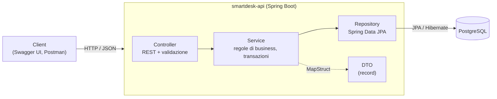
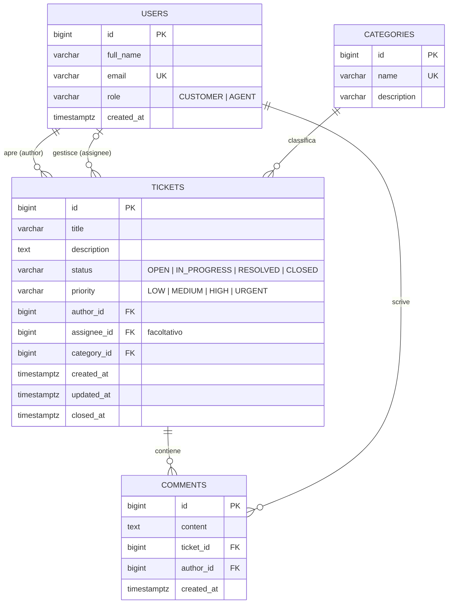

# SmartDesk

Sistema di gestione dei ticket di assistenza (helpdesk) sviluppato con **Java 21** e **Spring Boot 4**.

La versione attuale, **v0.1.0 – Backend base**, espone API REST complete per utenti, categorie, ticket e commenti, con regole di business, validazione, gestione centralizzata degli errori, paginazione e filtri. Le prossime versioni aggiungeranno test automatici e CI, un assistente AI con RAG (Spring AI + Qdrant) e un server MCP.

---

## Indice

- [Funzionalità](#funzionalità)
- [Stack tecnologico](#stack-tecnologico)
- [Architettura](#architettura)
- [Modello dati](#modello-dati)
- [Avvio rapido](#avvio-rapido)
- [Documentazione delle API](#documentazione-delle-api)
- [Endpoint](#endpoint)
- [Regole di business](#regole-di-business)
- [Gestione degli errori](#gestione-degli-errori)
- [Dati di esempio](#dati-di-esempio)
- [Struttura del progetto](#struttura-del-progetto)
- [Roadmap](#roadmap)

---

## Funzionalità

- **Utenti** con ruolo `CUSTOMER` (cliente) o `AGENT` (operatore di assistenza)
- **Categorie** per classificare i ticket
- **Ticket** con stato, priorità, autore, assegnatario e categoria
  - ricerca paginata con filtri facoltativi per stato, priorità, categoria e assegnatario
  - cambio di stato secondo un flusso definito (`OPEN → IN_PROGRESS → RESOLVED → CLOSED`)
  - assegnazione a un operatore
  - statistiche per stato e priorità
- **Commenti** sui ticket, in ordine cronologico
- **Validazione** degli input e **risposte di errore** in un formato unico
- **Migrazioni del database** versionate con Flyway, con dati di esempio pronti all'avvio

## Stack tecnologico

| Area | Tecnologie |
| --- | --- |
| Linguaggio e build | Java 21, Maven (progetto multi-modulo, Maven Wrapper) |
| Framework | Spring Boot 4.1, Spring Web MVC, Spring Data JPA / Hibernate, Bean Validation |
| Database | PostgreSQL 17, Flyway |
| Mapping | MapStruct 1.6 |
| Documentazione API | springdoc-openapi 3 (Swagger UI) |
| Test | JUnit 5, Mockito, Testcontainers |
| Infrastruttura | Docker, Docker Compose |
| Altro | Lombok |

## Architettura



Scelte principali:

- **Package organizzati per funzionalità** (`user`, `category`, `ticket`), ognuno con entità, repository, service, controller, DTO e mapper.
- **Le entità non escono mai dalle API**: i controller ricevono e restituiscono DTO (record Java), convertiti con MapStruct.
- **Le conversioni avvengono dentro le transazioni del service**, perché `spring.jpa.open-in-view` è disattivato e le relazioni sono caricate in modo `LAZY`.
- **`@EntityGraph`** sulle query di lettura dei ticket e dei commenti, per evitare il problema N+1.
- **Schema gestito solo da Flyway**: Hibernate si limita a verificarlo all'avvio (`ddl-auto: validate`).
- **Errori gestiti in un unico punto** (`GlobalExceptionHandler`), con un formato di risposta comune.

## Modello dati



Lo schema è definito in [`V1__init.sql`](smartdesk-api/src/main/resources/db/migration/V1__init.sql), i dati di esempio in [`V2__seed.sql`](smartdesk-api/src/main/resources/db/migration/V2__seed.sql).

## Avvio rapido

### Prerequisiti

- **JDK 21** o superiore
- **Docker** con Docker Compose (Docker Desktop su Windows e macOS)

Maven non è necessario: il progetto include il Maven Wrapper (`mvnw` / `mvnw.cmd`).

### 1. Avviare il database

```bash
docker compose up -d
```

Avvia PostgreSQL 17 sulla porta `5432` (database, utente e password: `smartdesk`).

### 2. Avviare l'applicazione

```bash
# Linux / macOS
./mvnw -pl smartdesk-api spring-boot:run

# Windows (PowerShell)
.\mvnw.cmd -pl smartdesk-api spring-boot:run
```

All'avvio Flyway crea le tabelle e carica i dati di esempio. L'API è disponibile su `http://localhost:8080/api/v1`.

### 3. Eseguire i test

```bash
./mvnw clean verify        # Windows: .\mvnw.cmd clean verify
```

I test avviano un PostgreSQL temporaneo con Testcontainers, quindi Docker deve essere in esecuzione.

### Ripristinare i dati di esempio

```bash
docker compose down -v     # elimina il container e il volume con i dati
docker compose up -d       # al prossimo avvio dell'app Flyway ricrea tutto
```

## Documentazione delle API

- **Swagger UI**: <http://localhost:8080/swagger-ui.html> — elenco degli endpoint, schemi dei DTO e prove direttamente dal browser
- **Descrizione OpenAPI** (JSON): <http://localhost:8080/v3/api-docs>
- **Collection Postman**: [`docs/smartdesk.postman_collection.json`](docs/smartdesk.postman_collection.json)

### Usare la collection Postman

1. In Postman: **Import** → seleziona il file `docs/smartdesk.postman_collection.json`.
2. La variabile `baseUrl` è già impostata su `http://localhost:8080/api/v1`.
3. Le richieste si possono provare una per una, oppure tutte insieme con il **Collection Runner**: le cartelle sono in ordine, ogni richiesta ha un test sul codice di risposta e la cartella finale elimina i dati creati.

I casi di errore della cartella 5 presuppongono i dati di esempio non modificati (vedi [Ripristinare i dati di esempio](#ripristinare-i-dati-di-esempio)).

## Endpoint

Tutti i percorsi sono relativi a `/api/v1`. Le liste paginate accettano `page` (da 0), `size` e `sort` (es. `sort=createdAt,desc`).

### Utenti

| Metodo | Percorso | Descrizione | Risposta |
| --- | --- | --- | --- |
| `GET` | `/users` | Lista paginata degli utenti | 200 |
| `GET` | `/users/by-role?role=AGENT` | Lista paginata (id e nome) per ruolo | 200 |
| `GET` | `/users/{id}` | Dettaglio di un utente | 200 · 404 |
| `POST` | `/users` | Crea un utente | 201 · 400 · 409 |
| `PUT` | `/users/{id}` | Modifica un utente | 200 · 400 · 404 · 409 |
| `DELETE` | `/users/{id}` | Elimina un utente | 204 · 404 · 409 |

### Categorie

| Metodo | Percorso | Descrizione | Risposta |
| --- | --- | --- | --- |
| `GET` | `/categories` | Lista paginata delle categorie | 200 |
| `GET` | `/categories/{id}` | Dettaglio di una categoria | 200 · 404 |
| `POST` | `/categories` | Crea una categoria | 201 · 400 · 409 |
| `PUT` | `/categories/{id}` | Modifica una categoria | 200 · 400 · 404 · 409 |
| `DELETE` | `/categories/{id}` | Elimina una categoria | 204 · 404 · 409 |

### Ticket

| Metodo | Percorso | Descrizione | Risposta |
| --- | --- | --- | --- |
| `GET` | `/tickets` | Lista paginata, filtri facoltativi `status`, `priority`, `categoryId`, `assigneeId` | 200 · 400 |
| `GET` | `/tickets/{id}` | Dettaglio di un ticket | 200 · 404 |
| `POST` | `/tickets` | Apre un ticket (stato iniziale `OPEN`) | 201 · 400 · 404 |
| `PUT` | `/tickets/{id}` | Modifica titolo, descrizione, priorità e categoria | 200 · 400 · 404 |
| `DELETE` | `/tickets/{id}` | Elimina un ticket e i suoi commenti | 204 · 404 |
| `PATCH` | `/tickets/{id}/status` | Cambia lo stato | 200 · 400 · 404 · 409 |
| `PATCH` | `/tickets/{id}/assignee` | Assegna a un operatore | 200 · 400 · 404 · 409 |
| `GET` | `/tickets/stats` | Totale e conteggi per stato e priorità | 200 |

### Commenti

| Metodo | Percorso | Descrizione | Risposta |
| --- | --- | --- | --- |
| `GET` | `/tickets/{id}/comments` | Commenti del ticket, dal più vecchio | 200 · 404 |
| `POST` | `/tickets/{id}/comments` | Aggiunge un commento | 201 · 400 · 404 |

### Esempi

Creazione di un ticket:

```http
POST /api/v1/tickets
Content-Type: application/json

{
  "title": "La stampante non risponde",
  "description": "Dalla mattina la stampante di rete risulta offline.",
  "priority": "MEDIUM",
  "authorId": 1,
  "categoryId": 3
}
```

Statistiche (`GET /api/v1/tickets/stats`) con i dati di esempio:

```json
{
  "total": 6,
  "byStatus":   { "OPEN": 2, "IN_PROGRESS": 2, "RESOLVED": 1, "CLOSED": 1 },
  "byPriority": { "LOW": 3, "MEDIUM": 1, "HIGH": 1, "URGENT": 1 }
}
```

## Regole di business

| Regola | Se violata |
| --- | --- |
| Un ticket nasce sempre `OPEN` | — |
| Passaggi di stato consentiti: `OPEN → IN_PROGRESS`, `IN_PROGRESS → RESOLVED`, `RESOLVED → CLOSED`, `RESOLVED → OPEN` (riapertura). Da `CLOSED` non si esce | 409 |
| Quando un ticket passa a `CLOSED` viene valorizzata la data di chiusura | — |
| Solo un utente `AGENT` può essere assegnatario | 409 |
| Email degli utenti e nomi delle categorie sono unici | 409 |
| Non si può eliminare una categoria che ha ticket | 409 |
| Non si può eliminare un utente che è autore o assegnatario di ticket, o autore di commenti | 409 |
| Eliminando un ticket si eliminano anche i suoi commenti | — |

## Gestione degli errori

Tutti gli errori hanno lo stesso formato:

```json
{
  "timestamp": "2026-11-24T15:30:12.345Z",
  "status": 400,
  "error": "Bad Request",
  "message": "Dati non validi",
  "path": "/api/v1/categories",
  "fieldErrors": {
    "name": "must not be blank"
  }
}
```

`fieldErrors` è presente solo per gli errori di validazione; il testo dei messaggi di validazione predefiniti dipende dalla lingua del sistema.

| Codice | Quando |
| --- | --- |
| 400 | Validazione fallita, JSON non leggibile, valore di enum non valido, parametro mancante o del tipo sbagliato |
| 404 | Risorsa inesistente |
| 409 | Dato duplicato, regola di business violata o vincolo del database |
| 500 | Errore inatteso (registrato nel log, senza dettagli interni nella risposta) |

## Dati di esempio

La migrazione `V2__seed.sql` carica:

| Id | Utente | Ruolo |
| --- | --- | --- |
| 1 | Mario Rossi | CUSTOMER |
| 2 | Giulia Bianchi | CUSTOMER |
| 3 | Luca Verdi | CUSTOMER |
| 4 | Anna Neri | AGENT |
| 5 | Paolo Gialli | AGENT |

- **Categorie**: 1 Account, 2 Fatturazione, 3 Tecnico, 4 Altro
- **Ticket**: 6, in tutti gli stati e con tutte le priorità, con e senza assegnatario
- **Commenti**: 5, sui ticket già presi in carico

## Struttura del progetto

```text
smartdesk/
├── pom.xml                     # POM padre (moduli, versioni)
├── docker-compose.yml          # PostgreSQL
├── docs/
│   └── smartdesk.postman_collection.json
└── smartdesk-api/
    ├── pom.xml
    └── src/
        ├── main/java/com/stefano/smartdesk/
        │   ├── SmartdeskApiApplication.java
        │   ├── common/         # ErrorResponse, PageResponse, eccezioni, GlobalExceptionHandler
        │   ├── user/           # User, UserRole, repository, service, controller, dto/, mapper/
        │   ├── category/       # Category, repository, service, controller, dto/, mapper/
        │   └── ticket/         # Ticket, Comment, enum, repository, service, controller, dto/, mapper/
        ├── main/resources/
        │   ├── application.yml
        │   └── db/migration/   # V1__init.sql, V2__seed.sql
        └── test/java/...       # test con Testcontainers
```

## Roadmap

| Versione | Contenuto | Stato |
| --- | --- | --- |
| **v0.1.0** | Backend base: API REST, regole di business, gestione errori, Swagger, collection Postman | Rilasciata |
| v0.2.0 | Test unitari e di integrazione (JUnit, Mockito, Testcontainers), GitHub Actions | Pianificata |
| v0.3.0 | Assistente AI: chatbot con RAG su una knowledge base (Spring AI, Qdrant, OpenAI / Ollama), chat memory | Pianificata |
| v0.4.0 | Server MCP con tool sui ticket (trasporti stdio e HTTP+SSE) | Pianificata |
| v1.0.0 | Rifinitura: demo, documentazione completa | Pianificata |

Sviluppi futuri valutati: autenticazione con Spring Security e JWT, disattivazione degli utenti invece dell'eliminazione, frontend.

---

Progetto di **Stefano Raffaele** — [github.com/stefanoraffaele39-art](https://github.com/stefanoraffaele39-art)
